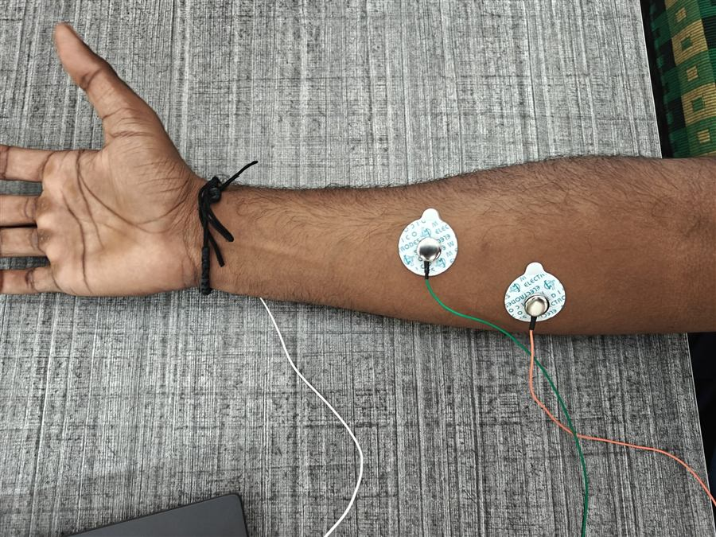

# NeuroKey

**NeuroKey** is a final-year engineering prototype exploring accessible control for people with severe motor impairments. Its planned input sequence is **SSVEP mode selection → EOG menu navigation → forearm EMG confirmation**. A laptop currently handles acquisition and processing; local Wi-Fi outputs for a small car and low-voltage home demonstrator are future integration stages.

This is a research prototype. It is not clinically validated and must not be used to control an occupied wheelchair or other safety-critical equipment.

## Current project status — 21 October 2026

### Demonstrated

- NPG Lite Beast Pack firmware was flashed and connected over Bluetooth.
- Signals were viewed in Chords Web and later acquired through the **ChordsPy BLE → LSL → laptop** route.
- Forearm contraction changed the recorded EMG waveform. Releasing, moving a lead, ordinary arm movement, and touching electrode snaps can also produce large changes.
- Rest and contraction recordings have been saved. One 22,500-sample laptop session contains nine paired rest/contraction trials.
- A laptop detector has sent UDP datagrams in a local software test. The ESP32 receiver and relay were not powered or listening, so packet receipt and physical actuation are unverified. The published experimental code keeps UDP output off unless the operator explicitly enables it.
- An OpenBCI-derived headset frame was 3D printed as an early mechanical prototype. It is retained as project history; the current roadmap does not depend on that frame.

### In progress

- Repeat EMG trials with clear labels and separate recording sessions.
- Replace cooldown-only repeat suppression with one-shot latch and quiet-release re-arming.
- Quantify false activations during ordinary arm activity and lead movement.
- Record EOG deliberately, then test EOG menu navigation.
- Add a two-second EMG confirmation window after a menu option is focused.

### Not yet demonstrated

- Reliable EOG classification or an EOG-controlled menu.
- Scalp EEG validation or SSVEP selection.
- The two-second command gate and emergency-stop arbitration.
- ESP32 receipt, relay switching, home-load operation, or car movement.
- End-to-end multimodal control.

## Planned interaction

```text
Look at a flickering target to select a mode (SSVEP — later stage)
                         ↓
Move eyes to navigate and focus an action (EOG — planned)
                         ↓
Focused action opens a 2-second confirmation window (planned)
                         ↓
Forearm contraction confirms; emergency-stop rule can override (EMG)
                         ↓
Laptop sends a bounded Wi-Fi command to a low-voltage demonstrator
```

The modules will be tested separately and joined with a deterministic state machine. The laptop remains the signal-processing host for this prototype. Standalone processing on an embedded controller is a later research option, not a current claim.

## First results and limits

The 21 Chords Web files currently analyzed comprise 10 relaxed recordings and 11 fist-labelled recordings. An exploratory 20–150 Hz bandpass plus 50 Hz notch analysis produced a difference in RMS distributions, with substantial overlap. The time axis assumes 500 Hz and the sample-counter anomalies have not yet been fully resolved. These recordings are useful for choosing the next tests; they are not a validated event classifier.


A separate 21 October session contains 11,250 relaxed and 11,250 contraction-labelled samples arranged as nine paired trials. In that session, active RMS exceeded rest RMS in all nine pairs (ratios 1.83×–5.22×). This is a within-session signal check, not a false-trigger or cross-session accuracy result. See [results/README.md](results/README.md).

A development run reported **94.44% hold-out window accuracy** from a random 80/20 split of 50%-overlapping windows. It is not cross-validation and does not estimate new-session performance. Adjacent windows can be similar, and the current training/live window lengths differ. Treat the score as preliminary software feedback only.

False activations have occurred during lead movement and ordinary arm movement. No validated false-activation rate, sensitivity, specificity, user-level reliability, or physical output performance is available. Earlier claims of “zero false triggers,” “artifact-immune” operation, or measured sub-millisecond UDP latency are unsupported and should not be repeated.

## Development order

1. Verify clean, repeatable EMG acquisition and preserve labelled recordings.
2. Compare a simple calibrated detector with the current SVM; validate using held-out sessions and artifact negatives.
3. Implement and test one-shot latching and release-to-rearm.
4. Record horizontal and vertical EOG and create a menu that can reject ambiguous input.
5. Test manual Wi-Fi commands with the receiver and a safe low-voltage indicator/load, without biosignal control.
6. Add the two-second EMG confirmation gate and test timeout, STOP, and connection-loss behavior.
7. Validate scalp EEG with an eyes-open/eyes-closed alpha test; only then begin one-target and multi-target SSVEP/FBCCA experiments.
8. Integrate the modalities and demonstrate scripted tasks on a stationary low-voltage home model and an unoccupied small car.

The original handoff lists initial goals of ≥95% EMG event detection with ≤1 false confirmation per five minutes, ≥90% held-out EOG balanced accuracy, 75–80% four-target SSVEP accuracy with rejection, and ≥90% scripted integrated task completion. These are future evaluation targets, not measured results.

## Repository map

- `docs/` — current status, roadmap, and bring-up steps
- `hardware/` — known inventory and items that still need label/rating verification
- `software/` — laptop-side development pipeline and its limitations
- `signal-processing/` — analysis notes and reproducible summary tools
- `results/` — aggregate plots and measured trial summaries; raw physiological recordings are kept out of the public repo
- `firmware/` — status of embedded output integration
- `media/` — prototype and experiment photographs

## Prototype photos

| Printed OpenBCI-derived headset | Headset print preparation |
|---|---|
|  |  |

| Ten20 conductive paste | Disposable gel electrodes |
|---|---|
|  |  |

| Forearm EMG electrode setup |
|---|
|  |

The headset was printed as a mechanical study piece based on the [OpenBCI Ultracortex Mark IV](https://github.com/OpenBCI/Ultracortex/tree/master/Mark_IV). It is not currently required for the EMG/EOG work. The reported 94.44% development score is shown as text above, not as an accuracy graphic: it came from a random overlapping-window split and is not validated new-session performance.

## Credits

- **OpenBCI Ultracortex Mark IV:** source design for the early printed headset frame, under the [GNU GPL v3.0](https://github.com/OpenBCI/Ultracortex/blob/master/LICENSE.md). The team does not claim the upstream geometry as original.
- **Upside Down Labs:** NPG Lite Beast Pack, firmware and hardware documentation, and Chords tools. See [NPG Lite documentation](https://docs.upsidedownlabs.tech/hardware/bioamp/neuro-play-ground-lite/index.html) and [Chords-Python](https://github.com/upsidedownlabs/Chords-Python).
- **NeuroKey team:** project-specific data collection, analysis, control logic, system integration, and prototype work.

## Team

Samith R · Nithin Patel GB · Rajmohan RA · Suhas RM
East Point College of Engineering and Technology, Bengaluru
