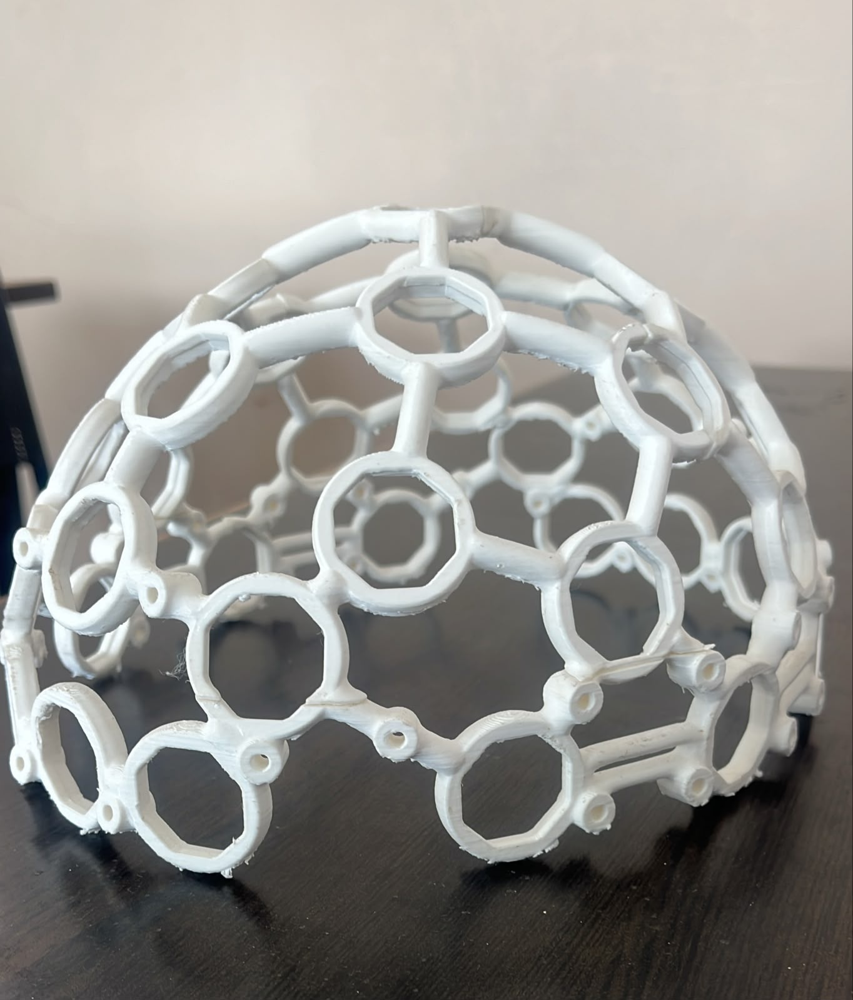
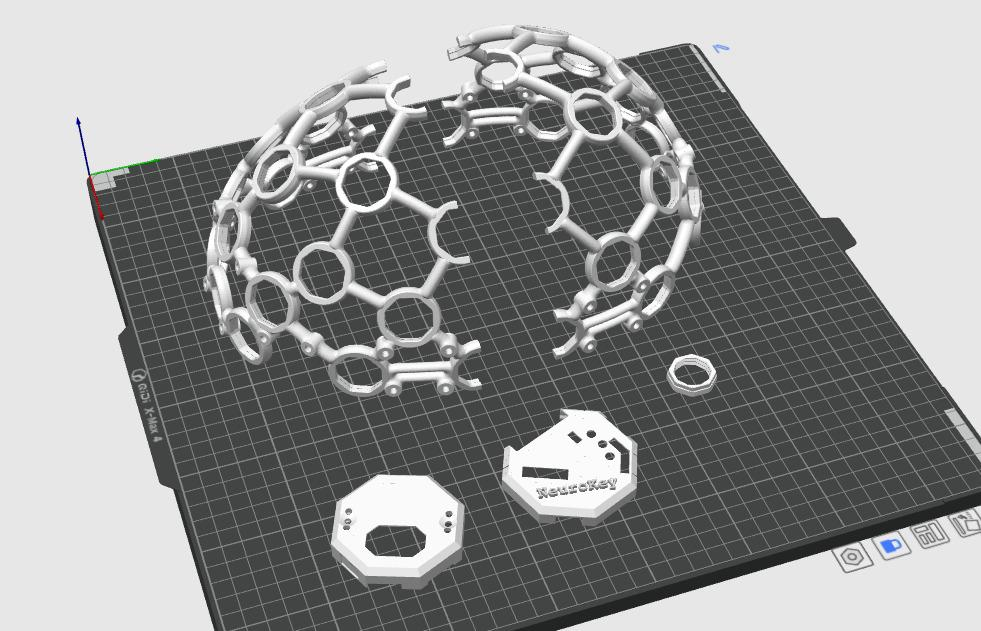
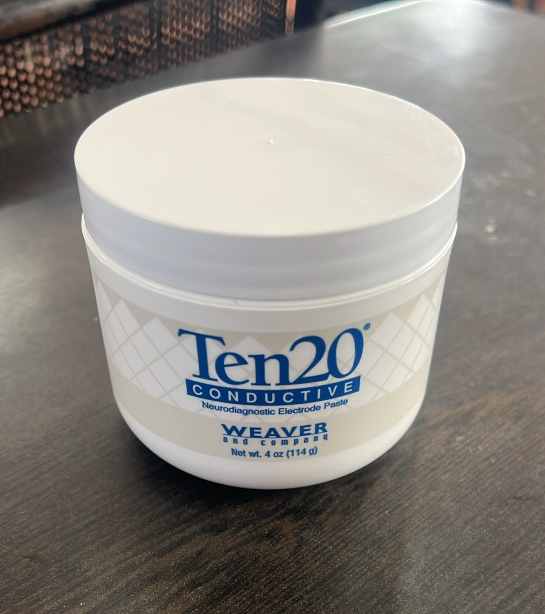
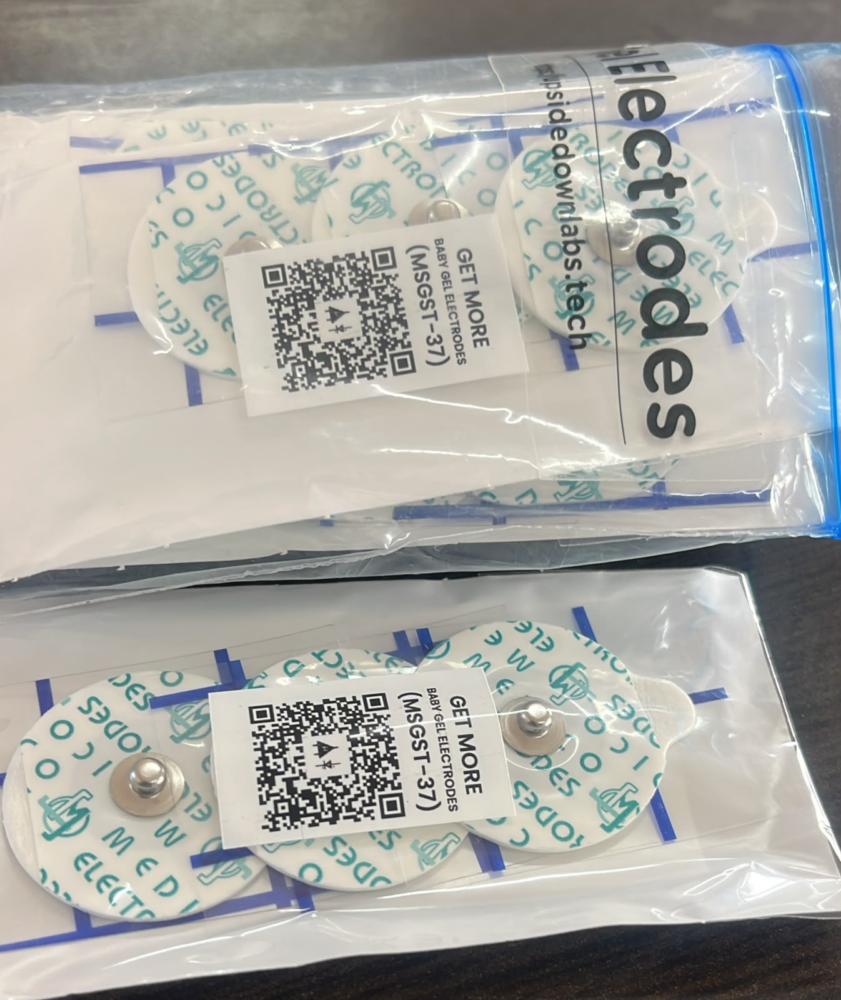

# NeuroKey

NeuroKey is a final-year engineering prototype exploring accessible control for people with severe motor impairments. The proposed system combines biosignals with a small wireless controller for low-voltage demonstrations. It is an academic prototype, not a medical device or powered-wheelchair controller.

## Current status

The team has an NPG Lite Beast Pack, Ten20 conductive paste, disposable gel electrodes, and a 3D-printed headset frame based on the OpenBCI Ultracortex design. The printed frame is for fit and electrode-placement prototyping; it does not mean EEG, EOG, or SSVEP control is working.

The active acquisition route for current forearm EMG work is **Beast Pack BLE → ChordsPy → LSL → laptop**. Preliminary clench detection has been demonstrated on the laptop. False activations have occurred during lead movement and ordinary arm movement. One-shot latching and command-context gating are planned; false-trigger testing and physical output integration remain in progress.

The laptop detector has sent UDP datagrams locally, but the ESP32 receiver and relay were not powered or listening during that test. Physical packet receipt and actuation have not been verified. A car platform has not yet been built or integrated.

## Prototype photos

| Printed OpenBCI-derived headset | Print preparation |
|---|---|
|  |  |

| Ten20 conductive paste | Disposable gel electrodes |
|---|---|
|  |  |

These photos document the printed frame and acquired consumables; they are not evidence of completed EEG, EOG, or SSVEP testing.

## Proposed interaction

```text
SSVEP: choose a control mode (planned)
        ↓
EOG: navigate and focus an option (planned)
        ↓
Focused option opens a 2-second confirmation window (planned)
        ↓
Forearm EMG: confirm only while the window is open (planned)
        ↓
Wi-Fi command to a low-voltage demonstrator (not end-to-end tested)
```

The two-second gate is a design proposal, not an implemented or validated feature. It should reduce unintended commands during navigation, but cannot by itself prove intent. An accessible assistance request and a stop/timeout behavior should remain available.

## Results and evidence limits

A development run reported **94.44% hold-out test accuracy** using a random 80/20 split of 250-sample windows with 50% overlap. This is not cross-validation and does not estimate performance on a new session: adjacent overlapping windows can be highly similar, and the split did not hold out complete sessions. Treat it as preliminary software feedback only. Session-grouped validation remains to be done.

There is no validated false-activation rate, sensitivity, specificity, or user-level reliability result yet. Earlier descriptions such as “zero false triggers,” “artifact-immune,” or measured sub-millisecond command latency are not supported by current evidence. The local UDP test did not verify ESP32 receipt, relay switching, car movement, or home-control action.

## Development stages

1. **EMG acquisition and detector:** continue with ChordsPy/LSL; stabilize electrodes and leads; record rest, intended confirmation, ordinary arm movement, and lead-motion examples. The team is integrating one-shot latching: a sustained clench should fire once and quiet rest should be required to re-arm.
2. **Command context:** add EOG menu navigation and a 2-second confirmation window; evaluate EMG only while an option is focused and the gate is open.
3. **Output bench test:** test wireless commands without biosignal control, first with a safe low-voltage indicator/load. Verify STOP, timeout, Wi-Fi loss, and restart behavior.
4. **Small mobility demonstrator:** build or adapt a small unoccupied car platform only after the output stage passes. Test with wheels raised first and at low speed in a clear area. Do not connect this prototype to a powered wheelchair.
5. **SSVEP and integration:** add SSVEP mode selection after EOG and EMG are individually repeatable. Validate each modality alone, then test the integrated state sequence with held-out sessions and logged failures.

Report trial count and duration, session split, intended-action detection, false activations per test duration, response time, and invalid/dropped signal periods. Mark a stage complete only when its pass criteria and evidence are recorded.

## Software bring-up

The active EMG acquisition route is **ChordsPy BLE → LSL → laptop**. From the project root, start the bridge in one terminal:

```powershell
python -m chordspy.connection --protocol ble
```

Then start the pipeline in another terminal:

```powershell
python software/unified_pipeline.py
```

The direct Bleak script, `neurokey_direct_ble.py`, was an early exploratory route with packet loss and operating-system GATT disconnects; it is not the active acquisition path. See [docs/START_HERE.md](docs/START_HERE.md).

## Hardware and open-source credits

- **Acquisition:** NPG Lite Beast Pack by [Upside Down Labs](https://upsidedownlabs.tech/); Ten20 paste and disposable gel electrodes are used in signal experiments.
- **Headset frame:** the printed frame is derived from the [OpenBCI Ultracortex Mark IV](https://github.com/OpenBCI/Ultracortex/tree/master/Mark_IV). NeuroKey does not claim the underlying geometry as original. The team-added NeuroKey-labelled component and local print work are prototype contributions. Follow the upstream [GNU GPL v3.0 license](https://github.com/OpenBCI/Ultracortex/blob/master/LICENSE.md) for redistributed derivatives.
- **Software references:** [Chords-Python](https://github.com/upsidedownlabs/Chords-Python), [NPG Lite documentation](https://docs.upsidedownlabs.tech/hardware/bioamp/neuro-play-ground-lite/index.html), and Upside Down Labs' open hardware/software examples. Adapted work must retain source attribution and license notices.

## Team

- Samith R
- Nithin Patel GB
- Rajmohan RA
- Suhas RM

## Scope and safety

NeuroKey is not clinically evaluated and is not suitable for controlling a person's wheelchair or other safety-critical equipment. Human-connected signal recording must use the battery-powered, isolated acquisition device as intended; do not connect electrodes to mains-powered circuits. Early actuator tests should use a low-voltage bench load or an unoccupied small platform, with a physical stop and time-limited commands.
