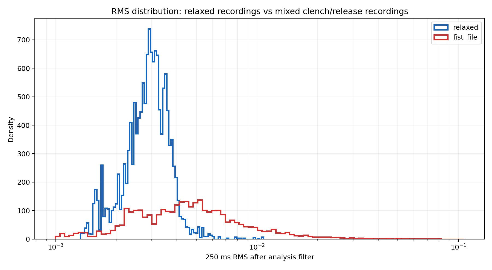

# EMG results

This folder contains aggregate summaries and plots. Raw biosignal recordings are not included in the public repository.

## September Chords Web exploratory recordings

The available analysis summarizes 10 files labelled relaxed and 11 files labelled fist/clench. Each CSV has a sample counter and one signal channel. Offline processing used a 20–150 Hz bandpass, 50 Hz notch, 250 ms RMS window, and 50 ms step. The time axes assume nominal 500 Hz; counter anomalies are visible and have not been fully interpreted.

The aggregate median 250 ms RMS was approximately **0.00305** for relaxed files and **0.00665** for fist-labelled files (about 2.18×). Their distributions overlap, and the fist-labelled recordings contain both lower-activity periods and bursts. This is evidence of a signal-level difference in these recordings, not sensitivity, specificity, classifier accuracy, or successful command control.

The published figure below shows the two file groups. The public repository includes the aggregate distribution and group summary only; it does not include the raw recordings or per-window values.

The numerical aggregate is in `emg_initial_analysis/group_summary.json`. Trace-level plots, per-window values, and raw recordings are retained locally rather than published.

The result files do not establish independent-participant performance. Re-record with separate sessions and verify sample timing before using these plots for model evaluation.

## 21 October laptop EMG session

The session file `session_20261021_122529.csv` contains 22,500 samples: 11,250 labelled rest and 11,250 labelled contraction, arranged in nine paired trials (1,250 rows per segment). The raw session CSV is kept locally and is not published. The aggregate table is included as `forearm_emg_session_20261021_trial_summary.csv`; `signal-processing/summarize_forearm_session.py` regenerates it from the private session CSV.

| Trial | Rest RMS | Contraction RMS | Ratio |
|---:|---:|---:|---:|
| 1 | 21.99 | 63.35 | 2.88× |
| 2 | 20.54 | 61.23 | 2.98× |
| 3 | 22.45 | 78.33 | 3.49× |
| 4 | 11.67 | 60.87 | 5.22× |
| 5 | 26.03 | 54.39 | 2.09× |
| 6 | 24.08 | 64.14 | 2.66× |
| 7 | 19.46 | 54.40 | 2.79× |
| 8 | 27.62 | 50.55 | 1.83× |
| 9 | 20.75 | 73.12 | 3.52× |

RMS values are in the recording pipeline's filtered signal units, not calibrated microvolts. Contraction RMS exceeded rest RMS in these nine pairs. This is one session and does not measure false activations during ordinary movement or prove a reliable command detector.

## Accuracy reporting

A development run reported 94.44% accuracy on a random 80/20 split of overlapping windows. Do not call this cross-validation. The split did not hold out whole sessions, and the current live window length differs from the training window length. The result is preliminary and must not be presented as product performance.
